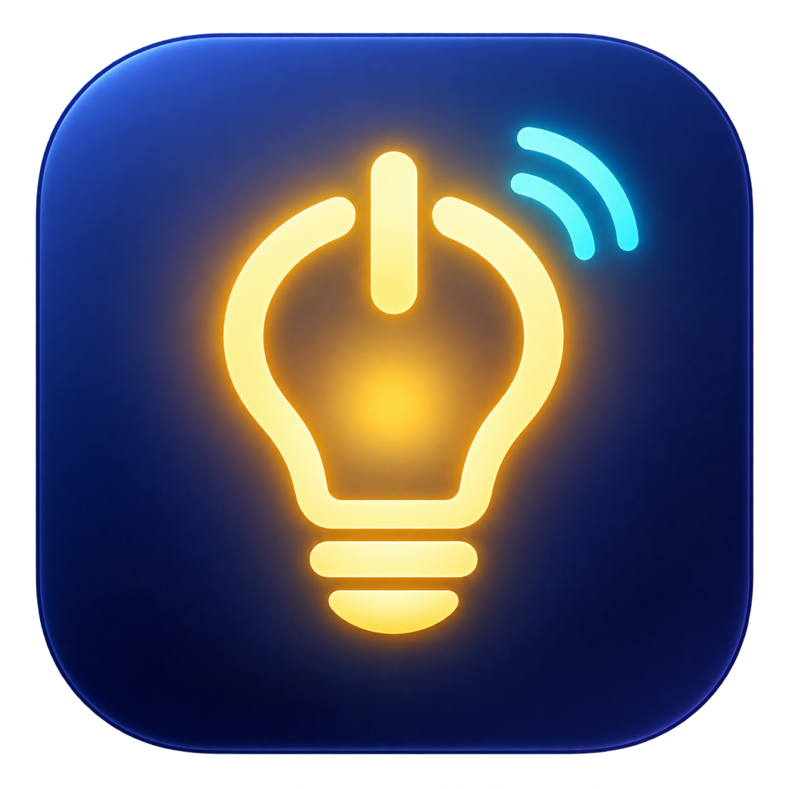
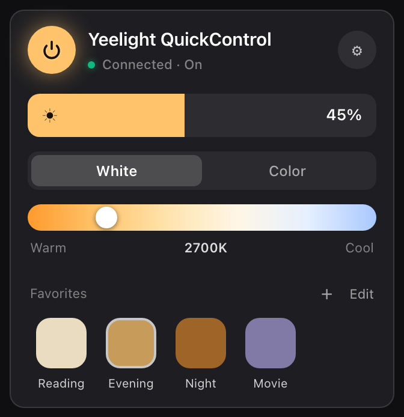
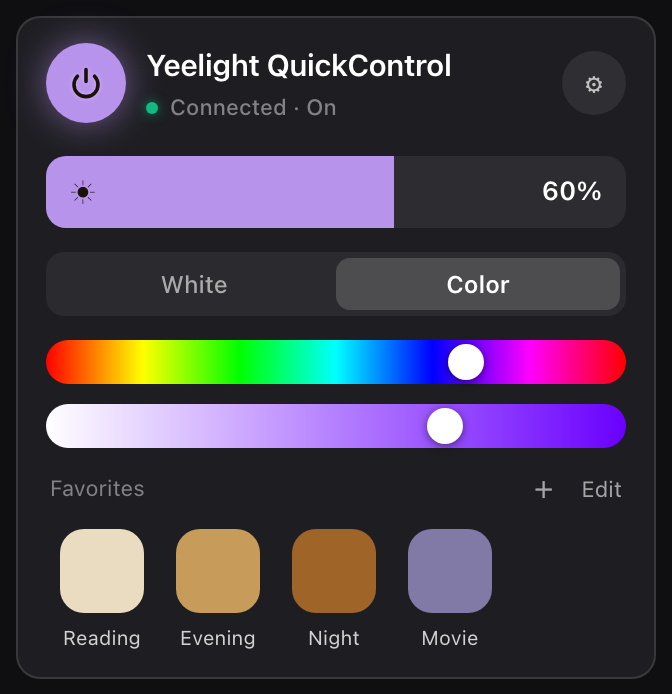
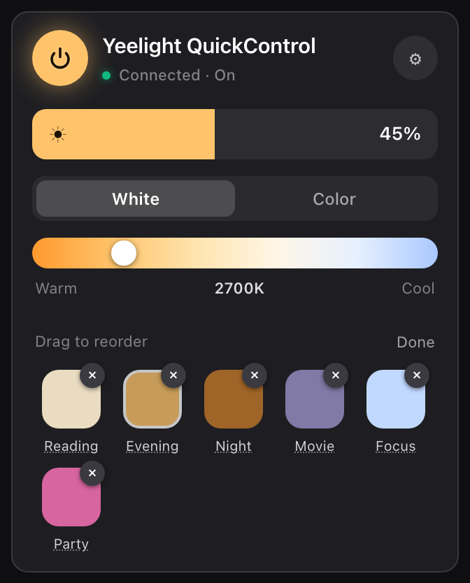
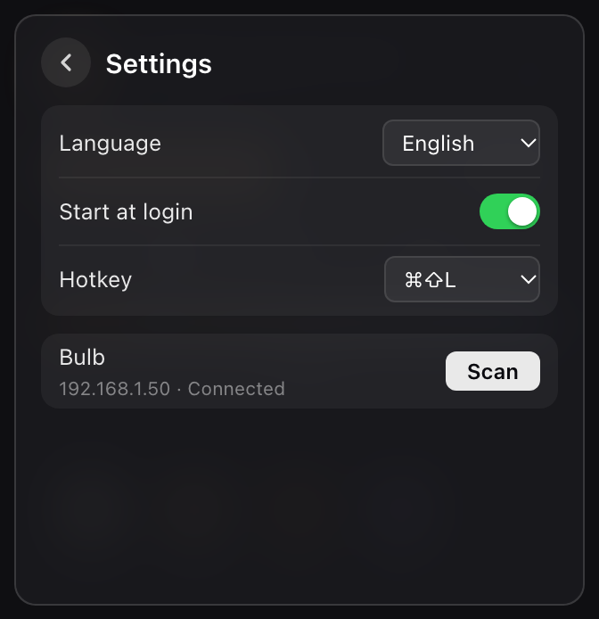

# 💡 Yeelight QuickControl

<p align="center">
  
</p>

<p align="center">
  <strong>Fast, lightweight macOS menu bar control for Yeelight smart bulbs.</strong><br>
  Native Swift status bar popover · No Node.js required · Instant SSDP discovery · Global keyboard shortcuts
</p>

<p align="center">Maintained by <strong>Utku Sakallıoğlu</strong></p>

<p align="center">
  <a href="https://github.com/utq745/yeelight-quickcontrol/releases/latest"></a>
  <a href="LICENSE.md"></a>
  
  
  
  
</p>

---

## 📸 Screenshots

<table>
  <tr>
    <td align="center"><strong>White light</strong></td>
    <td align="center"><strong>Color</strong></td>
  </tr>
  <tr>
    <td></td>
    <td></td>
  </tr>
  <tr>
    <td align="center"><strong>Favorites (edit mode)</strong></td>
    <td align="center"><strong>Settings</strong></td>
  </tr>
  <tr>
    <td></td>
    <td></td>
  </tr>
</table>

---

## ✨ Features

- 🪶 **Lightweight & Self-Contained:** A single native universal binary (Apple Silicon + Intel). No Node.js, no Electron, no helper process and no open network port—the app talks to the bulb directly.
- 🍎 **Native macOS Integration:** Sits unobtrusively in your menu bar (`NSStatusItem`) with an Apple-inspired dark glassmorphism popover.
- 📡 **Instant Discovery & Auto-Recovery:**
  - Fast **SSDP UDP Multicast discovery** (`239.255.255.250:1982`) finds your bulbs on your Wi-Fi within milliseconds.
  - Subnet TCP fallback scan that verifies each candidate actually speaks the Yeelight protocol.
  - If the connection drops (power cut, Wi-Fi hiccup, new DHCP lease), the app reconnects automatically with backoff and re-discovers the bulb if its IP changed.
- 🛡️ **Bulb-Friendly:** Commands are rate-limited below the bulb's ~60/min quota and slider drags are coalesced, so the bulb never drops the connection for flooding.
- ⌨️ **Global Keyboard Shortcut:**
  - Toggle your lights from anywhere with configurable hotkeys (e.g. `⌘ + ⇧ + L`, `Ctrl + ⇧ + L`, `⌥ + ⇧ + L`).
  - **Custom Combination Recorder:** Press any custom combination of keys and modifiers directly in the settings modal.
  - Powered by macOS native Carbon `RegisterEventHotKey` for zero-latency system-wide response.
- 🎛️ **Focused Lighting Controls:**
  - Power button in the header that glows in the bulb's current color.
  - Smooth **Brightness** bar (1%–100%).
  - **White / Color** switch that shows only the controls for the active mode: a warm-to-cool **Color Temperature** slider (1700K–6500K), or **Hue** and **Saturation** sliders.
- ⭐ **Favorites:** Save the current light (mode, color or temperature, brightness) with one tap, rename, reorder (drag and drop) or delete it in edit mode, and restore it instantly. Favorites use the bulb's `set_scene` command, so color and brightness change together without flicker, and they also turn the bulb on. Up to 12 favorites, shared between the app and the standalone mode.
- 🌐 **Multi-Language Support:** English, Turkish, French, Portuguese, Chinese, German and Italian with instant runtime UI switching and localized menu bar context menus.
- 🚀 **Autostart Support:** The app enables automatic startup on first launch; it can be turned off or on again from the in-app Settings panel.

---

## 📋 Prerequisites

- **macOS 13.0 (Ventura)** or newer, on Apple Silicon or Intel.
- **Xcode Command Line Tools** (only needed if building from source):
  ```bash
  xcode-select --install
  ```

---

## 💡 Yeelight Setup (First Time)

To allow local network communication with your Yeelight bulb:

1. Open the official **Yeelight** or **Mi Home** app on your smartphone.
2. Select your bulb and tap the **Settings** / **More** icon.
3. Enable **LAN Control** (Local Network Control).
4. Make sure your Mac and your Yeelight bulb are connected to the same Wi-Fi network.
5. On first launch, allow **Local Network** access when macOS asks (System Settings → Privacy & Security → Local Network).

---

## 🛠️ Build & Installation

### Quick Build

After publishing the repository, clone your copy and run the build script:

```bash
git clone https://github.com/utq745/yeelight-quickcontrol.git
cd yeelight-quickcontrol

# Build Yeelight QuickControl.app
./build.sh
```

To launch the compiled app:
```bash
open "Yeelight QuickControl.app"
```

### Packaging a Distributable `.dmg`

To create a release-ready macOS Disk Image (`.dmg`):

```bash
./build.sh --dmg
# Output: YeelightQuickControl-macOS.dmg
```

### Publishing a GitHub Release

Downloadable app files belong under **GitHub Releases**, not GitHub Packages.
GitHub Packages is intended for package registries such as npm and container
images, while a Release can directly host the DMG and ZIP files users download.

The release workflow builds an ad-hoc-signed DMG and ZIP archive and publishes
their SHA-256 checksums whenever a version tag is pushed. The tag must match the
version in `package.json`:

```bash
git tag v1.1.0
git push origin v1.1.0
```

You can also run the Release workflow manually from GitHub Actions to download
the same files as workflow artifacts without creating a GitHub Release.

### Standalone Web Controller Mode

The macOS app does not need Node.js. If you prefer a browser (or another OS), the same dashboard can be served by a zero-dependency Node.js script (Node 18+):

```bash
npm start
# Opens http://127.0.0.1:7655
```

It shares the settings file with the app, binds to loopback only, and rejects requests whose `Host`/`Origin` is not its own.

### Running Tests

```bash
npm test             # standalone controller, against a fake bulb (Node 18+)
npm run test:macos   # native Swift controller, against a fake bulb
YEELIGHT_QUICKCONTROL_SELFTEST=1 "Yeelight QuickControl.app/Contents/MacOS/YeelightQuickControl"
                     # dashboard ↔ native bridge inside a real WKWebView
```

CI runs all three on every push.

---

## ⚙️ Architecture

```
┌──────────────────────────────────────────────────────────────┐
│  macOS app (single native binary)                            │
│                                                              │
│  SmartLights.swift ── menu bar item, popover, hot key,       │
│        │              login item                             │
│        ▼                                                     │
│  WKWebView ── dashboard.html                                 │
│        │  fetch('/api/…') via private yeelight-app:// scheme │
│        ▼                                                     │
│  AppSchemeHandler.swift ── same JSON API as server.js        │
│        ▼                                                     │
│  YeelightController.swift ── TCP client, reconnect,          │
│        │                     rate limiting                   │
│  Discovery.swift ── SSDP + verified subnet probe             │
└────────┼─────────────────────────────────────────────────────┘
         │ TCP 55443 (JSON) / SSDP UDP 1982
         ▼
   Yeelight bulb (local Wi-Fi)
```

- **`macos/SmartLights.swift`:** Menu bar icon (`NSStatusItem`), popover with `WKWebView`, Carbon global hot key, login item (`SMAppService`).
- **`macos/AppSchemeHandler.swift`:** Serves the dashboard and its API through a private URL scheme. Nothing listens on a network port, so other apps and websites cannot reach the controller.
- **`macos/YeelightController.swift`:** Bulb connection over `Network.framework`: request-ID matching for property replies, automatic reconnection with backoff and re-discovery, token-bucket rate limiting with latest-value coalescing.
- **`macos/Discovery.swift`:** SSDP multicast discovery with a verified TCP subnet probe as fallback.
- **`macos/ConfigStore.swift`:** Settings in `~/.yeelight-quickcontrol.json` (shared with the standalone mode).
- **`dashboard.html`:** Responsive UI with sliders, shortcut recorder and seven-language localization. Runs unchanged in the app and in a browser.
- **`server.js`:** Optional standalone controller for browsers, exposing the same API on `127.0.0.1:7655`.

---

## 🔗 Controlling the Light from Other Apps

### URL scheme

Any app or script can send commands with a `yeelight-quickcontrol://` URL. If the app is not running, macOS starts it and the command runs as soon as the bulb is connected.

| URL | Action |
|---|---|
| `yeelight-quickcontrol://toggle` | Toggle power |
| `yeelight-quickcontrol://on` · `…://off` | Power on / off |
| `yeelight-quickcontrol://brightness/40` | Set brightness (turns the light on) |
| `yeelight-quickcontrol://brightness/up` · `…/down?step=5` | Step brightness (default 10) |
| `yeelight-quickcontrol://white/2700` | White light at 2700 K |
| `yeelight-quickcontrol://color/250/60` | Color: hue 0–359, saturation 0–100 |
| `yeelight-quickcontrol://favorite/1` · `…/favorite/Reading` | Apply a favorite by position or name |

Try it from Terminal: `open "yeelight-quickcontrol://toggle"`

### Logi Options+ and other "open application" launchers

Some tools can only open an application, not a URL (Logi Options+ Smart Actions, for example, turns custom URLs into web addresses). For them the app ships tiny background helpers that send one command and quit immediately:

```
/Applications/Yeelight QuickControl.app/Contents/Helpers/
  Toggle Light.app    Light On.app    Light Off.app
  Brightness Up.app   Brightness Down.app
  Favorite 1.app … Favorite 4.app
```

In Logi Options+: create a Smart Action, choose **Open application**, and paste a helper path, e.g. `/Applications/Yeelight QuickControl.app/Contents/Helpers/Toggle Light.app`. (In a file dialog, press <kbd>⌘</kbd><kbd>⇧</kbd><kbd>G</kbd> to type the path, since Finder does not browse inside app bundles.)

---

## ⌨️ Global Shortcut Configuration

1. Left-click the menu bar icon to open the dashboard.
2. Click the ⚙️ gear icon to open **Settings**.
3. Under **Global Shortcut (Kısayol Tuşu)**:
   - Select one of the default presets (`Cmd + Shift + L`, `Ctrl + Shift + L`, `Option + Shift + L`), **or**
   - Choose **Custom Combination (Özel Kombinasyon)** and press your desired key combination directly on your keyboard.
4. The shortcut is saved immediately and registered system-wide without restarting the app.

The app also registers itself to start automatically when you sign in to macOS. Use the in-app Settings panel to disable or re-enable this behavior.

---

## 🔐 Unsigned Builds

Builds are ad-hoc signed for bundle integrity, but they are not Developer ID signed or notarized yet. macOS may therefore block a downloaded build on first launch. Right-click **Yeelight QuickControl.app**, choose **Open**, then confirm **Open**. The source and GitHub Actions workflow remain available for users who prefer to build locally.

---

## 🙏 Acknowledgements

Yeelight QuickControl was inspired by [Smart Lights for Yeelight at its final original revision](https://github.com/ishiharas/Smart-Lights-Yeelight/tree/e3df28c50d4c50144c8e8ddf6120a7104a141f89), an Angular/Electron project released under GPL-3.0. This version is an independent Swift rewrite (with an optional Node.js standalone mode); it does not include the original Angular/Electron source code. See [NOTICE.md](NOTICE.md) for provenance and licensing details.

---

## 🤝 Contributing

Contributions, feature requests, and bug reports are welcome!
Feel free to open an issue or submit a pull request:

1. Fork the repository
2. Create your feature branch (`git checkout -b feature/my-new-feature`)
3. Commit your changes (`git commit -am 'Add some feature'`)
4. Push to the branch (`git push origin feature/my-new-feature`)
5. Open a Pull Request

---

## 📄 License

The current Yeelight QuickControl implementation is licensed under the [Apache License, Version 2.0](LICENSE.md). Historical code from the original GPL-3.0 project remains governed by its original license; see [NOTICE.md](NOTICE.md).
