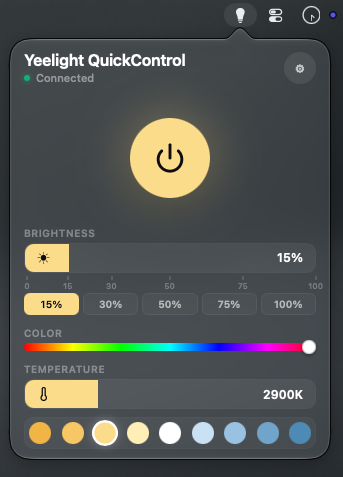
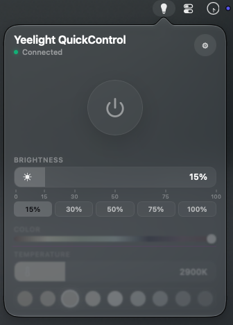

# 💡 Yeelight QuickControl

<p align="center">
  
</p>

<p align="center">
  <strong>Fast, lightweight macOS menu bar control for Yeelight smart bulbs.</strong><br>
  Native Swift status bar popover · Zero npm dependencies · Instant SSDP discovery · Global keyboard shortcuts
</p>

<p align="center">Maintained by <strong>Utku Sakallıoğlu</strong></p>

<p align="center">
  <a href="https://github.com/utq745/yeelight-quickcontrol/releases/latest"></a>
  <a href="LICENSE.md"></a>
  
  
  
  
</p>

---

## 📸 Screenshots

<table>
  <tr>
    <td align="center"><strong>Light on</strong></td>
    <td align="center"><strong>Light off</strong></td>
  </tr>
  <tr>
    <td></td>
    <td></td>
  </tr>
</table>

---

## ✨ Features

- 🪶 **Ultra-Lightweight & Fast:** The entire macOS `.app` bundle is only **~1.2 MB** (DMG installer ~1.5 MB) and consumes negligible system resources—a modern, featherlight replacement for bloated Electron applications.
- 🍎 **Native macOS Integration:** Sits unobtrusively in your menu bar (`NSStatusItem`) with an Apple-inspired dark glassmorphism popover.
- 🔌 **Zero External NPM Dependencies:** The background controller uses 100% pure Node.js standard libraries (`http`, `net`, `dgram`, `os`, `fs`). No `node_modules` folder or third-party packages required.
- 📡 **Instant Discovery & Auto-Recovery:**
  - Fast **SSDP UDP Multicast discovery** (`239.255.255.250:1982`) finds your bulbs on your Wi-Fi within milliseconds.
  - Subnet TCP fallback scan ensures reliable detection across diverse router setups.
  - Automatic IP re-discovery reconnects seamlessly if your router reassigns DHCP leases.
- ⌨️ **Global Keyboard Shortcut:**
  - Toggle your lights from anywhere with configurable hotkeys (e.g. `⌘ + ⇧ + L`, `Ctrl + ⇧ + L`, `⌥ + ⇧ + L`).
  - **Custom Combination Recorder:** Press any custom combination of keys and modifiers directly in the settings modal.
  - Powered by macOS native Carbon `RegisterEventHotKey` for zero-latency system-wide response.
- 🎛️ **Comprehensive Lighting Controls:**
  - One-tap master power toggle with live state feedback.
  - Smooth **Brightness Slider** (1%–100%) with contrast-aware typography and 5 one-tap presets.
  - Interactive **Color Temperature Slider** (1700K Warm Amber – 6500K Cool Daylight) with live Kelvin readout and 9 curated presets.
  - Full-spectrum **Color Hue Slider** for RGB ambiance.
  - Automatic dimming and locking of color/temperature controls when the bulb is switched off.
- 🌐 **Multi-Language Support:** English, Turkish, French, Portuguese, Chinese, German and Italian with instant runtime UI switching and localized menu bar context menus.
- 🚀 **Autostart Support:** The app enables automatic startup on first launch; it can be turned off or on again from the in-app Settings panel.

---

## 📋 Prerequisites

- **macOS 13.0 (Ventura)** or newer (Apple Silicon build; Intel support will require a separate x86_64 build).
- **[Node.js](https://nodejs.org/)** (v16.0 or higher) available in your system path.
- **Xcode Command Line Tools** (only needed if building from source):
  ```bash
  xcode-select --install
  ```

---

## 💡 Yeelight Setup (First Time)

To allow local network communication with your Yeelight bulb:

1. Open the official **Yeelight** or **Mi Home** app on your smartphone.
2. Select your bulb and tap the **Settings** / **More** icon.
3. Enable **LAN Control** (Local Network Control).
4. Make sure your Mac and your Yeelight bulb are connected to the same Wi-Fi network.

---

## 🛠️ Build & Installation

### Quick Build

After publishing the repository, clone your copy and run the build script:

```bash
git clone https://github.com/utq745/yeelight-quickcontrol.git
cd yeelight-quickcontrol

# Build Yeelight QuickControl.app
./build.sh
```

To launch the compiled app:
```bash
open "Yeelight QuickControl.app"
```

### Packaging a Distributable `.dmg`

To create a release-ready macOS Disk Image (`.dmg`):

```bash
./build.sh --dmg
# Output: YeelightQuickControl-macOS.dmg
```

### Publishing a GitHub Release

Downloadable app files belong under **GitHub Releases**, not GitHub Packages.
GitHub Packages is intended for package registries such as npm and container
images, while a Release can directly host the DMG and ZIP files users download.

The release workflow builds an ad-hoc-signed DMG and ZIP archive and publishes
their SHA-256 checksums whenever a version tag is pushed. The tag must match the
version in `package.json`:

```bash
git tag v1.0.1
git push origin v1.0.1
```

You can also run the Release workflow manually from GitHub Actions to download
the same files as workflow artifacts without creating a GitHub Release.

### Standalone Web Controller Mode

You can also run the Node.js backend independently in any browser without the Swift menu bar wrapper:

```bash
npm start
# Opens http://127.0.0.1:7655
```

---

## ⚙️ Architecture

```
┌────────────────────────────────┐
│   macOS Menu Bar StatusItem    │
│      (SmartLights.swift)       │
└──────────────┬─────────────────┘
               │ Embeds
               ▼
┌────────────────────────────────┐       HTTP / JSON       ┌───────────────────────────────┐
│     WKWebView UI Popover       │ ◄─────────────────────► │     Local Node.js Daemon      │
│   (Apple Glassmorphism UI)     │                         │   (server.js on 127.0.0.1)    │
└────────────────────────────────┘                         └──────────────┬────────────────┘
                                                                          │ Raw TCP / SSDP UDP
                                                                          │ Port 55443 (JSON API)
                                                                          ▼
                                                           ┌───────────────────────────────┐
                                                           │      Yeelight Smart Bulb      │
                                                           │         (Local Wi-Fi)         │
                                                           └───────────────────────────────┘
```

- **`SmartLights.swift`:** Manages the macOS menu bar icon (`NSStatusItem`), spawns and supervises the Node.js background process, registers global Carbon hotkeys, and presents the `WKWebView` popover.
- **`dashboard.html`:** Clean, responsive client UI with hardware-accelerated sliders, SVG graphics, custom shortcut recorder, and seven-language localization dictionaries.
- **`server.js`:** Pure Node.js daemon bound to loopback `127.0.0.1:7655`. Handles SSDP discovery, TCP socket management to port 55443, local configuration persistence (`~/.yeelight-quickcontrol.json`), and periodic state polling.

---

## ⌨️ Global Shortcut Configuration

1. Left-click the menu bar icon to open the dashboard.
2. Click the ⚙️ gear icon to open **Settings**.
3. Under **Global Shortcut (Kısayol Tuşu)**:
   - Select one of the default presets (`Cmd + Shift + L`, `Ctrl + Shift + L`, `Option + Shift + L`), **or**
   - Choose **Custom Combination (Özel Kombinasyon)** and press your desired key combination directly on your keyboard.
4. The shortcut is saved immediately and registered system-wide without restarting the app.

The app also registers itself to start automatically when you sign in to macOS. Use the in-app Settings panel to disable or re-enable this behavior.

---

## 🔐 Unsigned Builds

Builds are ad-hoc signed for bundle integrity, but they are not Developer ID signed or notarized yet. macOS may therefore block a downloaded build on first launch. Right-click **Yeelight QuickControl.app**, choose **Open**, then confirm **Open**. The source and GitHub Actions workflow remain available for users who prefer to build locally.

---

## 🙏 Acknowledgements

Yeelight QuickControl was inspired by [Smart Lights for Yeelight at its final original revision](https://github.com/ishiharas/Smart-Lights-Yeelight/tree/e3df28c50d4c50144c8e8ddf6120a7104a141f89), an Angular/Electron project released under GPL-3.0. This version is an independent Swift and Node.js rewrite; it does not include the original Angular/Electron source code. See [NOTICE.md](NOTICE.md) for provenance and licensing details.

---

## 🤝 Contributing

Contributions, feature requests, and bug reports are welcome!
Feel free to open an issue or submit a pull request:

1. Fork the repository
2. Create your feature branch (`git checkout -b feature/my-new-feature`)
3. Commit your changes (`git commit -am 'Add some feature'`)
4. Push to the branch (`git push origin feature/my-new-feature`)
5. Open a Pull Request

---

## 📄 License

The current Yeelight QuickControl implementation is licensed under the [Apache License, Version 2.0](LICENSE.md). Historical code from the original GPL-3.0 project remains governed by its original license; see [NOTICE.md](NOTICE.md).
